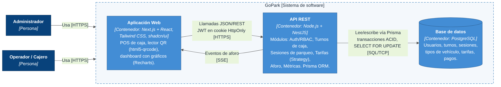

# GoPark

Plataforma web para la gestión y el control vehicular en parqueaderos comerciales pequeños y medianos: check-in y check-out con ticket QR, motor automático de tarifas, turnos de caja con arqueo, control de aforo y dashboard administrativo.

> Proyecto del curso **Ingeniería de Software III (FI303290)** — Institución Universitaria Antonio José Camacho, período 2026-2.
> Docente: Ing. José Lizardo Castro Guaraca.

## Estado del proyecto

| Sprint | Fechas | HU | Estado |
|---|---|---|---|
| 1 — Arquitectura base, autenticación y turnos de caja | 30/09 – 14/10 | HU-01, HU-02, HU-09 | ✅ Terminado ([detalle](docs/sprint-1/README.md)) |
| 2 — Registro operativo, tarifas y tickets QR | 14/10 – 28/10 | HU-03, HU-04 | ⏳ Pendiente |
| 3 — Control de aforo y lector QR | 28/10 – 11/11 | HU-05, HU-06 | ⏳ Pendiente |
| 4 — Panel administrativo, métricas y despliegue | 11/11 – 25/11 | HU-07, HU-08 | ⏳ Pendiente |

Gestión Scrum en Notion: [Gestión de GoPark](https://app.notion.com/p/Gesti-n-de-GoPark-109c7975363383b1aaa00170da18e3d9)

## Problema

En Cali circulan en promedio 800.000 vehículos al día (Alcaldía de Santiago de Cali, 2024). Muchos parqueaderos todavía registran placas en papel, liquidan fracciones a mano y cierran la caja sin arqueo. Eso genera fugas de dinero, filas en horas pico y ninguna visibilidad sobre el aforo y los ingresos.

## Estructura del repositorio

```
GoPark/
├── apps/
│   ├── api/          API REST — NestJS 10 + Prisma 6 + PostgreSQL 16
│   └── web/          Aplicación web — Next.js 14 + Tailwind CSS
├── docs/
│   ├── adr/          Decisiones de arquitectura (ADR)
│   ├── arquitectura/ Diagramas C4 y de despliegue (Mermaid + PNG)
│   ├── sprint-1/     Entrega del Sprint 1 (criterios, pruebas, pantallas)
│   ├── scrum/        Burndown
│   └── informes/     Informes del curso
├── index.html, style.css   Landing page (HU-09)
├── docker-compose.yml
└── .github/          CI (GitHub Actions) y plantilla de Pull Request
```

## Cómo ejecutar

### Opción A — Docker (todo en un comando)

```bash
docker compose up --build
```

- Web: http://localhost:3000
- API: http://localhost:4000 · Swagger: http://localhost:4000/docs

### Opción B — Local (Node.js 20 y PostgreSQL 16)

```bash
# 1. Base de datos (si no tienes PostgreSQL instalado)
docker compose up -d db

# 2. API
cd apps/api
cp .env.example .env            # revisa DATABASE_URL y JWT_SECRET
npm install                     # también ejecuta "prisma generate"
npx prisma migrate deploy       # crea las tablas
npm run prisma:seed             # usuarios demo
npm run start:dev               # http://localhost:4000

# 3. Web (en otra terminal)
cd apps/web
cp .env.example .env.local      # JWT_SECRET debe ser IGUAL al de la API
npm install
npm run dev                     # http://localhost:3000
```

### Usuarios demo

| Rol | Correo | Contraseña |
|---|---|---|
| Administrador | admin@gopark.co | Admin123* |
| Operador (cajero) | operador@gopark.co | Operador123* |

## Pruebas

```bash
cd apps/api
npm test            # 20 pruebas unitarias
npm run test:e2e    # 16 pruebas end-to-end contra PostgreSQL (requiere migración y seed)
```

GitHub Actions ejecuta en cada Pull Request: lint, verificación de tipos, pruebas unitarias, migración, pruebas e2e y build de la API y de la web, además de HTMLHint sobre la landing.

## Funcionalidades

| Módulo | Descripción | HU | Estado |
|---|---|---|---|
| Autenticación y roles | JWT en cookie HttpOnly, roles ADMIN y OPERATOR | HU-01 | ✅ |
| Turnos de caja | Apertura con base, cierre con arqueo esperado vs. declarado | HU-02 | ✅ |
| Landing page | Página informativa | HU-09 | ✅ |
| Check-in express | Registro por placa y tipo, ticket QR | HU-03 | ⏳ |
| Tarifas y check-out | Minutos de gracia, fracción, hora y tarifa nocturna (patrón Strategy) | HU-04 | ⏳ |
| Lector QR | Escaneo con la cámara web | HU-05 | ⏳ |
| Aforo concurrente | Reserva atómica del cupo (`SELECT ... FOR UPDATE`) | HU-06 | ⏳ |
| Dashboard | Aforo en vivo, ingresos y horas pico | HU-07 | ⏳ |
| CI/CD y despliegue | GitHub Actions, Vercel, Render y Supabase | HU-08 | 🔄 CI listo |

## Arquitectura

Monolito modular documentado con el modelo C4. Los diagramas están escritos como código (Mermaid) en [`docs/arquitectura`](docs/arquitectura) y las decisiones se registran en [`docs/adr`](docs/adr).



## Equipo y roles Scrum

| Integrante | Rol |
|---|---|
| Dilan Sneider García Bedoya | Product Owner · Developer |
| Nicolás Agudelo Martínez | Scrum Master · Developer |
| José García Cadena | Developer |

## Flujo de trabajo

1. Una rama por historia: `feature/HU-XX-descripcion`.
2. Pull Request hacia `main` con la plantilla del repositorio.
3. Revisión de al menos un compañero y CI en verde antes del merge.

## Uso de IA

Según la política del curso, el uso de asistentes de IA se declara en los commits y en las entregas. Parte del código del Sprint 1 se generó con un asistente de IA (Claude) y el equipo lo revisó.

## Referencias

- Alcaldía de Santiago de Cali. (2024, 3 de septiembre). *Operativos de control vial: la apuesta de la Alcaldía de Cali para disminuir los altos índices de accidentalidad*. https://www.cali.gov.co/publicaciones/182713/
- Brown, S. (s.f.). *The C4 model for visualising software architecture*. https://c4model.com
- Schwaber, K. y Sutherland, J. (2020). *La Guía de Scrum*. https://scrumguides.org
