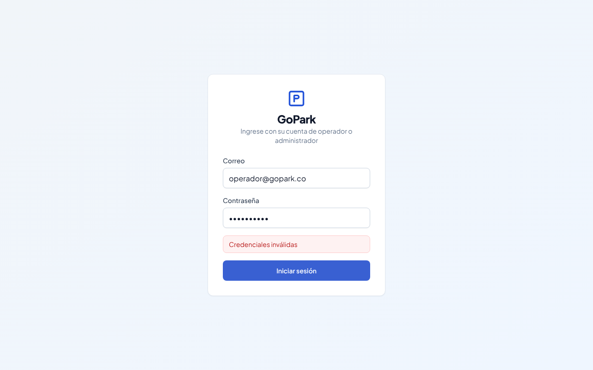
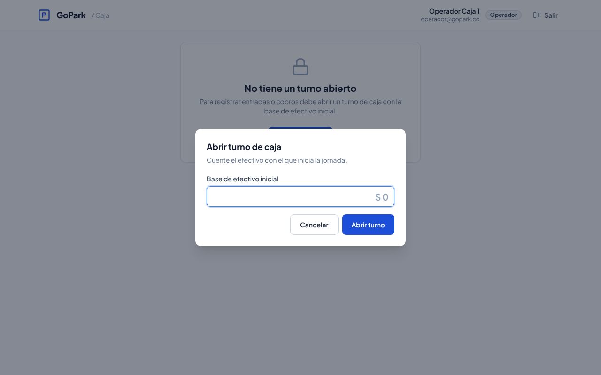
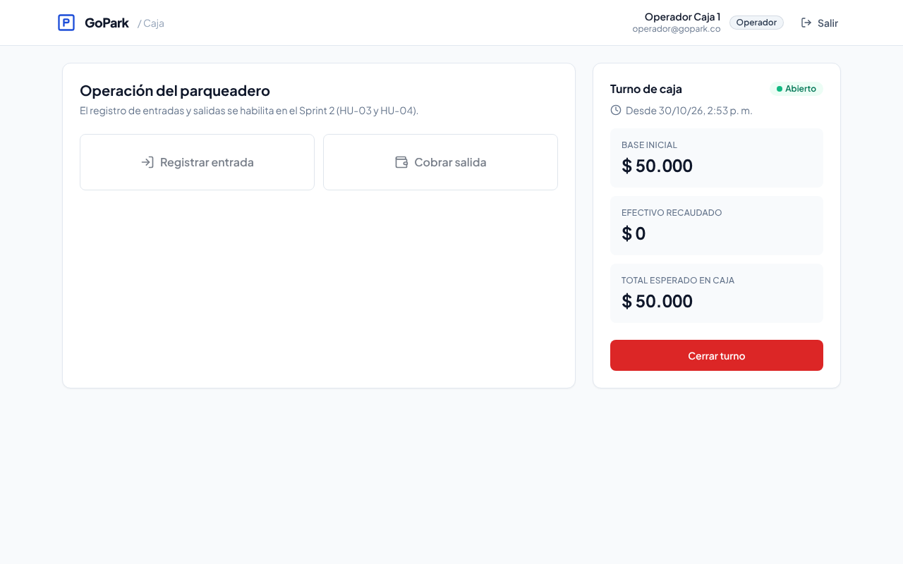
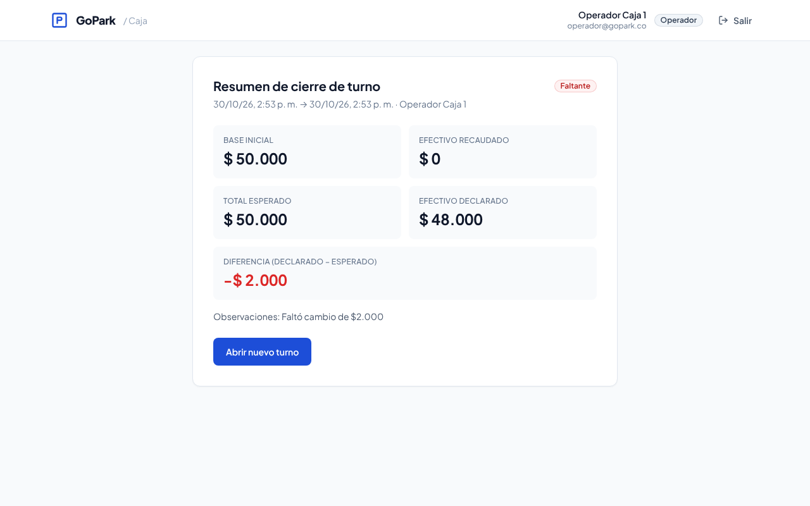
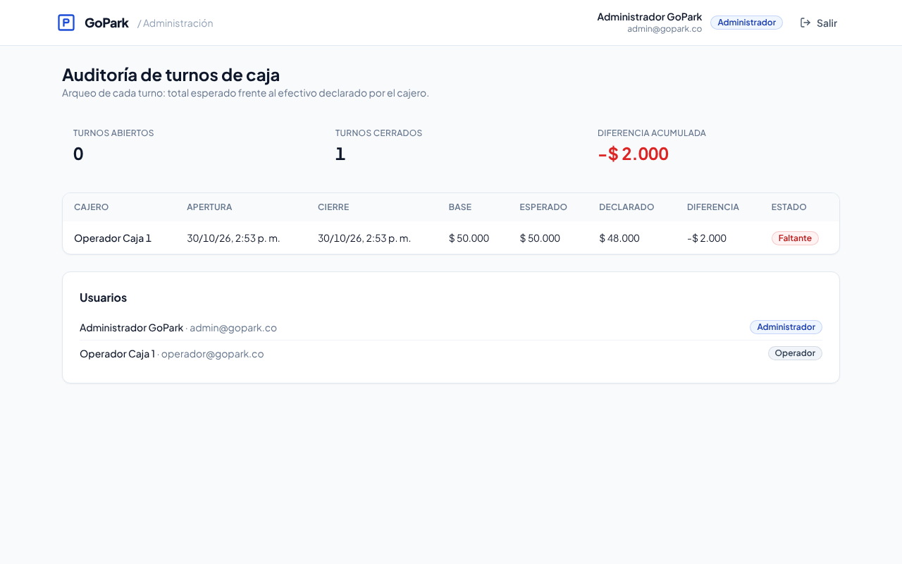

# Sprint 1 — Arquitectura base, autenticación y turnos de caja

**Fechas:** 30/09/2026 – 14/10/2026 (cerrado el 30/10/2026)
**Objetivo:** tener la infraestructura base, el control de acceso por roles y la apertura y cierre de turnos de caja.

| HU | Título | SP | Estado |
|---|---|---|---|
| HU-01 | Autenticación y control de acceso por roles | 8 | Hecha |
| HU-02 | Gestión de turnos de caja (Cash Shifts) | 5 | Hecha |
| HU-09 | Landing page informativa | 3 | Hecha |

---

## HU-01 — Autenticación y control de acceso por roles

> Como administrador/cajero, quiero iniciar sesión con credenciales seguras y acceder a las vistas de mi rol.

### Criterios de aceptación

| Criterio | Cómo se cumple | Evidencia |
|---|---|---|
| JWT seguro almacenado en cookie HttpOnly | `POST /auth/login` firma el JWT y lo guarda en la cookie `gopark_token` (HttpOnly, SameSite=Lax y Secure en producción) | `apps/api/src/auth/auth.controller.ts` · e2e «guarda el JWT en una cookie HttpOnly» · prueba de navegador «JavaScript no puede leer el token» |
| El operador solo accede a caja/operación; el administrador, a métricas y configuración | `RolesGuard` global con `@Roles()` en la API; middleware de Next.js redirige `/admin` y `/caja` según el rol | `apps/api/src/auth/guards.ts` · `apps/web/src/middleware.ts` · e2e 403 cruzados |
| Middleware de protección de rutas en frontend y API | API: `JwtAuthGuard` global (todo protegido salvo `@Public()`). Web: `middleware.ts` verifica la firma del JWT con `jose` | e2e «sin cookie responde 401» · navegador «ruta protegida redirige a /login» |

### Subtareas

- [x] Proyecto base: Next.js 14 + Tailwind (componentes estilo shadcn/ui), NestJS 10, Prisma 6, PostgreSQL 16
- [x] Modelo `User` y enum `Role` (ADMIN, OPERATOR) en Prisma
- [x] Endpoints de registro (`POST /users`, solo ADMIN) y login con contraseñas hasheadas (bcrypt)
- [x] Middleware de autenticación y manejo de sesión (`/auth/me`, `/auth/logout`)
- [x] Vista de login y redirección según el rol

---

## HU-02 — Gestión de turnos de caja

> Como cajero, quiero abrir un turno con una base de efectivo inicial y cerrarlo al finalizar mi jornada.

### Criterios de aceptación

| Criterio | Cómo se cumple | Evidencia |
|---|---|---|
| No se registran entradas ni cobros sin un turno abierto | `ShiftsService.assertOpenShift()` y `OpenShiftGuard` (lanzan 403 si no hay turno). Check-in y check-out los usarán en el Sprint 2. En la web, la operación se bloquea hasta abrir el turno | `apps/api/src/shifts/open-shift.guard.ts` · pruebas unitarias de `assertOpenShift` |
| El cierre calcula el total esperado frente al efectivo declarado | `countCash()`: esperado = base + recaudado; diferencia = declarado − esperado → CUADRADO / FALTANTE / SOBRANTE | `apps/api/src/shifts/shift-math.ts` · 4 pruebas unitarias · e2e «cierra el turno comparando esperado vs. declarado» |
| (Adicional) Un cajero no puede tener dos turnos abiertos | Validación en el servicio + índice único parcial en PostgreSQL (`WHERE status = 'OPEN'`) que resiste solicitudes simultáneas | e2e «dos aperturas simultáneas: solo una se acepta» |

### Subtareas

- [x] Tabla `CashShift` vinculada a `User` (apertura, cierre, base, recaudado, esperado, declarado, diferencia)
- [x] Endpoints `POST /shifts/open` y `POST /shifts/close`
- [x] Modal de apertura de caja con validación del monto inicial
- [x] Vista de resumen de cierre de turno
- [x] (Adicional) Auditoría de turnos para el administrador (`GET /shifts`)

---

## Endpoints (Swagger en `http://localhost:4000/docs`)

| Método | Ruta | Rol | Descripción |
|---|---|---|---|
| POST | `/auth/login` | Público | Inicia sesión (cookie HttpOnly) |
| POST | `/auth/logout` | Público | Borra la cookie |
| GET | `/auth/me` | Autenticado | Usuario actual |
| GET | `/users` | ADMIN | Lista usuarios |
| POST | `/users` | ADMIN | Registra usuario con rol |
| GET | `/shifts/current` | OPERATOR | Turno abierto del cajero |
| POST | `/shifts/open` | OPERATOR | Abre turno con base |
| POST | `/shifts/close` | OPERATOR | Cierra turno y hace el arqueo |
| GET | `/shifts?status=` | ADMIN | Auditoría de turnos |
| GET | `/shifts/:id` | ADMIN o dueño | Detalle de turno |
| GET | `/health` | Público | Estado de la API y la BD |

## Pruebas

| Tipo | Cantidad | Comando |
|---|---|---|
| Unitarias (Jest) | 20 | `cd apps/api && npm test` |
| End-to-end API contra PostgreSQL (Jest + Supertest) | 16 | `cd apps/api && npm run test:e2e` |
| Flujo en navegador (Playwright, manual) | 15 verificaciones | login, cookie HttpOnly, apertura, cierre, redirecciones por rol, logout |

## Pantallas

| Login con error | Apertura de turno |
|---|---|
|  |  |

| Turno abierto | Resumen de cierre |
|---|---|
|  |  |

**Auditoría del administrador**

## Definition of Done

- [ ] Code review por un compañero (Pull Request)
- [x] Pruebas unitarias pasan
- [x] Probado manualmente en el entorno de desarrollo
- [ ] Integrado a `main` sin conflictos (al hacer merge del PR)
- [ ] Aceptado por el Product Owner (Dilan)
- [ ] Historia marcada «Done» en Notion

## Uso de IA

Parte del código de este sprint se generó con un asistente de IA (Claude). Así lo exige la política del curso, que pide declararlo en commits y entregas. Cada integrante debe poder explicar el código: este documento y los ADR describen cada decisión.
